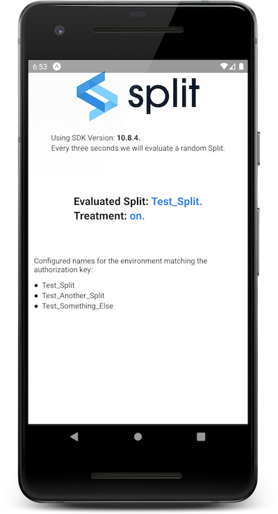

# Split React Native SDK example application with Expo.

This project was bootstrapped with [Expo-CLI](https://docs.expo.dev/more/expo-cli/) using [create-expo-app](https://docs.expo.dev/get-started/create-a-project/).

```sh
$ npx create-expo-app ExpoExample
$ cd ExpoExample/
$ npx expo install @splitsoftware/splitio-react-native
```

## Table of Contents
* [Setup](#prerrequisites)
* [Available Scripts](#available-scripts)
  * [npm start](#npm-start)
  * [npm test](#npm-test)
  * [npm run ios](#npm-run-ios)
  * [npm run android](#npm-run-android)
  * [npm run eject](#npm-run-eject)

## Setup

You'll need [Node.js](https://nodejs.org/en/download/). This project was created with an old version of Node.js (v16.16.0) and we **recommend using the same version** to avoid any issues. So consider installing [Node.js Version Manager](https://github.com/nvm-sh/nvm) to manage different versions of Node.js, and running the commands `nvm install` and `nvm use` in the project's root directory to set the correct version before following the next steps.

To run the app, first replace the `'<SDK-KEY>'` string in the App.js file with the SDK key of client-side type of your Split environment.

Optionally, you can try a [localhost configuration](https://help.split.io/hc/en-us/articles/4406066357901-React-Native-SDK#localhost-mode) as the example below:

```javascript
import { SplitFactory } from '@splitsoftware/splitio-react-native';

const factory = SplitFactory({
  core: {
    authorizationKey: 'localhost',
    key: 'some_key',
  },
  features: {
    test_feature_flag: 'on',
    test_another_feature_flag: 'dark',
    test_something_else: 'off',
  },
});
```

<!-- TODO: Is `npm install && npx expo install` the way? -->
Then install dependencies with `npm install && npx expo install` and run the project in the Web or a Mobile simulator with `npm start`.

When running you should see a screen like the image below (taken from an Android device).



If any error rises when trying to run the app in the Android or iOS emulator, consider updating Expo-Cli, or uninstalling the **Expo Go** app in your emulator to let Expo-Cli install a compatible version.

More information on the available scripts below.

## Available Scripts

### `npm start`

Runs your app in development mode.

Open it in the [Expo app](https://expo.io) on your phone to view it. It will reload if you save edits to your files, and you will see build errors and logs in the terminal.

### `npm test`

Runs the [jest](https://github.com/facebook/jest) test runner on your tests.

If you're looking for how to test with Split SDK, you can mock the module import (see [Jest documentation](https://jestjs.io/docs/jest-object#jestmockmodulename-factory-options)) using the [localhost mode](https://help.split.io/hc/en-us/articles/4406066357901-React-Native-SDK#localhost-mode) of the SDK, which is what we're doing [here](./__tests__/App.test.js).

### `npm run ios`

Like `npm start`, but also attempts to open your app in the iOS Simulator if you're on a Mac and have it installed.

### `npm run android`

Like `npm start`, but also attempts to open your app on a connected Android device or emulator.

### `npm run eject`

This will start the process of "[ejecting](https://docs.expo.dev/expokit/eject/)" your Expo managed project, in order to be handled as part of a larger standard native project (a.k.a bare project) -- one that you would normally create using Xcode, Android Studio, or `react-native init`.
